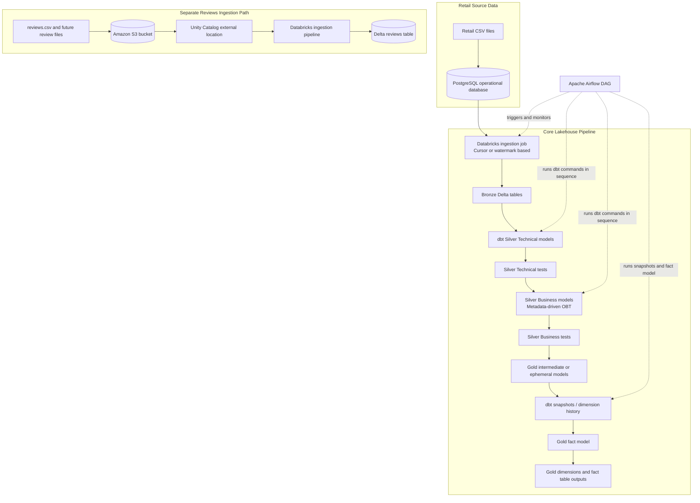

# Metadata-Driven Retail Lakehouse Pipeline

A retail data engineering project that brings together PostgreSQL, Databricks, Delta Lake, dbt, Python, SQL, Amazon S3, and Apache Airflow. The pipeline is organized around a medallion-style lakehouse architecture, reusable metadata-driven SQL transformations, dimensional modeling, and task orchestration.

The project also demonstrates a separate ingestion path for manager-supplied customer review files stored in Amazon S3. That review dataset is intentionally separate from the core retail dimensional model.

## Table of Contents

- Project Overview
- Business and Engineering Goals
- Technology Stack
- Architecture
- Data Sources
- Pipeline Walkthrough
- Medallion Layers
- Metadata-Driven dbt Transformations
- Dimensional Modeling
- Airflow Orchestration
- Amazon S3 Reviews Ingestion
- Repository Structure
- Prerequisites
- Configuration
- Running the Local Airflow Environment
- Validation Checklist
- Troubleshooting
- Security Notes
- Current Scope and Limitations
- Learning References

## Project Overview

Retail data is often distributed across operational entities such as customers, products, stores, employees, orders, and order items. This project demonstrates how these entities can be ingested, standardized, joined, tested, and published into analytical tables using a lakehouse-oriented workflow.

The core path uses a PostgreSQL operational database as the source. A Databricks ingestion job loads source data into Delta tables, after which dbt manages SQL-based transformations. The transformation layers separate source-aligned technical models from business-facing models and the final Gold dimensional outputs. Apache Airflow coordinates the main ingestion and dbt workflow.

A second path handles customer reviews. Review CSV files are placed in Amazon S3, accessed from Databricks through a Unity Catalog external location, and ingested into a Delta streaming table for separate managerial analysis.

## Business and Engineering Goals

### Business goal

Provide a structured analytical foundation for retail data by consolidating operational data into consistent, queryable tables. The resulting models can support downstream analysis, reporting, and other data consumers.

### Engineering goals

- Organize data into Bronze, Silver, and Gold layers.
- Support incremental ingestion of new or updated source records through a cursor/watermark-based approach and upsert logic.
- Keep source-aligned cleaning separate from business-oriented transformations.
- Use dbt models, tests, snapshots, and Jinja templating to manage SQL transformation logic.
- Build a Gold dimensional model consisting of fact and dimension tables.
- Orchestrate dependent pipeline stages through an Airflow DAG.
- Demonstrate a separately managed S3 ingestion route for customer reviews.

## Technology Stack

| Technology | Role |
|---|---|
| PostgreSQL | Operational source database for the simulated retail entities. |
| Ghost.build and MCP (optional setup workflow) | Supports agent-assisted database setup and interaction in the tutorial workflow; it is not the lakehouse transformation or orchestration engine. |
| Python | Supporting scripts and pipeline utilities, including source dataset loading. |
| Databricks | Managed environment for Spark processing, Delta tables, ingestion jobs, and SQL execution. |
| Apache Spark / PySpark | Reads and processes source data and supports table ingestion within Databricks. |
| Delta Lake | Table storage format for the lakehouse layers, with transactional table operations and support for updates and history features. |
| dbt Core | Organizes SQL transformations into models and provides commands for source freshness, tests, runs, and snapshots. |
| dbt-databricks | dbt adapter for Databricks. |
| Jinja | Generates reusable SQL from model configuration and metadata. |
| Apache Airflow | Coordinates the dependency order of ingestion and dbt tasks. |
| Docker Compose | Runs a local multi-container Airflow environment for development. |
| Amazon S3 | Object storage for the separate customer-review CSV ingestion path. |
| Unity Catalog | Governs Databricks access to external S3 storage through an external location and storage credential. |

## Architecture



> **Architecture note:** The core PostgreSQL-to-Gold workflow and the S3 reviews workflow are distinct paths. The review table is not described as part of the core dimensional data model. The Airflow DAG triggers a configured Databricks ingestion job and then executes dbt stages. The S3 review ingestion is configured separately in Databricks.

## Data Sources

### 1. PostgreSQL retail dataset

The repository includes a simulated retail dataset and a SQL schema definition. The CSV files are used to populate source tables in PostgreSQL.

| File | Entity represented |
|---|---|
| `customers.csv` | Customer records |
| `employees.csv` | Employee records |
| `order_items.csv` | Order line items |
| `orders.csv` | Order records |
| `products.csv` | Product records |
| `stores.csv` | Store records |

Supporting files:

- `walmart_dataset/ddl/walmart_schema.sql` defines the source database schema.
- `walmart_dataset/load_data.py` supports loading the dataset into the source database. Review its connection configuration before running it.

### 2. Customer reviews in Amazon S3

The additional review input is `reviews.csv`. In the demonstrated workflow, it is uploaded into an S3 bucket and ingested through Databricks. New review files can be added later for recurrent ingestion, depending on the configured Databricks pipeline and trigger settings.


## Optional Agent-Assisted Database Setup

The project also demonstrates an agent-assisted workflow for interacting with a hosted PostgreSQL database using Ghost.build and a Model Context Protocol (MCP) server. In that setup, an AI-enabled development client can invoke approved database tools to help create schema objects, load CSV data, inspect tables, and run exploratory queries.

MCP is the tool-connection layer between the AI client and the tools it is allowed to call. It is not a database engine, lakehouse storage layer, transformation framework, or scheduler. PostgreSQL stores the operational data, Databricks processes and stores lakehouse tables, dbt manages transformations, and Airflow orchestrates the main pipeline.

This agent-assisted setup is optional. The core architecture depends on a reachable PostgreSQL source and the configured Databricks/dbt/Airflow components, not on an AI assistant being present during every pipeline run.

## Pipeline Walkthrough

### Stage 1: Load the operational source

The simulated retail CSVs and `walmart_schema.sql` provide the source data and schema. The data-loading script supports inserting the CSV data into PostgreSQL tables. PostgreSQL serves as the operational source for the core lakehouse pipeline.

### Stage 2: Incremental ingestion into Databricks

The Airflow DAG includes an `ingest_cdc` task that invokes a Databricks job using the Databricks SDK and waits for the job to reach a terminal state. The ingestion design described for the project uses a cursor or watermark to identify records to process and applies matching/upsert logic to the Bronze Delta tables.

A cursor-based incremental extraction can reduce the need to reload every source row for every run. Correctness still depends on how the watermark is chosen and advanced, how matching keys are handled, and how retries are made safe.


### Stage 3: Bronze Delta tables

Bronze is the landing layer for source-aligned data. Its purpose is to retain an accessible representation of the ingested source records before downstream business transformations. Delta tables allow table operations such as inserts and updates to be managed transactionally.

The Bronze layer should remain close to the source structure. Audit metadata such as ingestion timestamps, source identifiers, or file details can improve lineage when those columns are included by the ingestion implementation.

### Stage 4: Silver Technical models

The Silver Technical layer contains source-aligned transformations. dbt models standardize data and organize the SQL logic into manageable components. The DAG runs `dbt run --select silver_t` and then `dbt test --select silver_t`.

Keeping the technical models separate makes it easier to identify whether a problem originates in ingestion, source standardization, or a downstream business transformation.

### Stage 5: Silver Business models and the One Big Table

The Silver Business layer combines relevant entities for business-oriented consumption. The project uses metadata-driven SQL generation with Jinja templates so table names, column selections, and join definitions can be managed through configuration rather than duplicated across a large set of hard-coded join queries.

A wide combined model is often described as a **One Big Table (OBT)**. It is a consumption-oriented table, not a replacement for the Gold dimensional model. The DAG runs `dbt run --select silver_b` followed by `dbt test --select silver_b`.

Dynamic SQL requires careful validation. Join keys, expected row cardinality, duplicate column names, missing metadata, and schema changes can all affect the generated query and its results.

### Stage 6: Gold dimensional model

The Gold layer provides business-facing analytical structures. The project separates this work into intermediate or ephemeral models, dimension history through dbt snapshots, and a fact model.

The DAG runs the Gold intermediate/ephemeral selector, runs `dbt snapshot`, and then runs the Gold fact selector. Snapshots can preserve changes in dimension attributes when the snapshot definitions and strategies are configured accordingly. The precise historical behavior depends on those snapshot configurations.

Fact table grain is a key design decision. For example, one row per order is different from one row per order item. Measures and dimension joins should be validated against the chosen grain so that joins do not multiply transaction values unexpectedly.

### Stage 7: Customer reviews ingestion

The review ingestion is configured as a separate Databricks path:

1. Upload `reviews.csv` to the S3 bucket.
2. Configure secure Databricks access through a Unity Catalog external location backed by an appropriate storage credential.
3. Select the review file or configure the ingestion pipeline to monitor the relevant folder, depending on the chosen Databricks setup.
4. Ingest the source data into a Delta table for review analysis.
5. Add subsequent review files as required by the configured ingestion process.

In the project, the resulting Delta table is created separately for managerial/product-context analysis and is not part of the main dimension model.

## Medallion Layers

| Layer | Responsibility | Typical output |
|---|---|---|
| Bronze | Land source data with minimal business transformation. | Delta tables representing ingested source entities. |
| Silver Technical | Standardize source-aligned structures and run technical data tests. | Reusable, cleaned technical models. |
| Silver Business | Apply business-oriented joins and metadata-driven SQL generation. | Wide analytical model / OBT. |
| Gold | Publish dimensional analytical tables. | Dimensions and a fact table. |

The layers provide separation of concerns: ingestion, technical standardization, business integration, and analytical modeling can be inspected and validated independently.

## Metadata-Driven dbt Transformations

The project uses dbt to organize transformations and Jinja to generate reusable SQL from configuration or metadata.

A metadata-driven pattern separates **what should be joined or selected** from the template that generates the SQL. This can reduce repeated SQL and make a model easier to extend when multiple entities follow similar joining patterns.

Typical responsibilities in this project include:

- Defining the source and model structure in dbt project configuration.
- Generating SQL through Jinja templates and project metadata.
- Building Silver Technical and Silver Business models.
- Running source freshness checks before transformation stages.
- Running dbt tests after the technical and business model groups.
- Using dbt snapshots for configured dimension-history tracking.
- Building the final fact model after the required upstream stages complete.

Useful dbt commands used by the Airflow workflow include:

```bash
dbt source freshness
dbt run --select silver_t
dbt test --select silver_t
dbt run --select silver_b
dbt test --select silver_b
dbt run --select gold/ephermeral
dbt snapshot
dbt run --select gold/fact
```

Run these commands from the dbt project directory with a valid dbt profile and access to the configured Databricks workspace. The selector names must match the folders and model configuration in the checked-out project.

## Dimensional Modeling

The Gold layer is designed around a star-schema approach. The main concepts are:

- **Fact table:** represents a business event or transaction and contains measures and keys to relevant dimensions.
- **Dimension tables:** provide descriptive context such as customer, product, store, employee, or date, depending on the implemented model.
- **Surrogate or business keys:** support relationships between fact and dimension records.
- **Dimension snapshots:** track changes over time when configured in dbt.


## Airflow Orchestration

The local Airflow environment is defined through Docker Compose. The DAG is located at `airflow_dbt_project/dags/orchestrate.py` and uses Airflow task decorators and Bash operators to execute the pipeline stages.

The main dependency order in the DAG is:

1. Trigger the configured Databricks ingestion job and wait for its result.
2. Clean generated dbt `target` and `logs` directories.
3. Run `dbt source freshness`.
4. Run Silver Technical models.
5. Test Silver Technical models.
6. Run Silver Business models.
7. Test Silver Business models.
8. Run the Gold intermediate/ephemeral selector.
9. Run dbt snapshots.
10. Run the Gold fact selector.

Each stage is a distinct Airflow task so task status and logs can help locate failures. 
The DAG currently contains placeholder values for the Databricks workspace host, token, and job ID. These must be configured before the ingestion task can invoke a real Databricks job. For a hardened implementation, store credentials in Airflow Connections, environment variables, or an appropriate secret backend rather than embedding secrets in DAG code.

## Amazon S3 Reviews Ingestion

Amazon S3 is used as object storage for the separate reviews input. S3 stores files; Databricks performs the ingestion and writes the resulting table. S3 itself does not perform the data transformations.

### Access path

- **S3 bucket:** stores the uploaded review CSV and any later review files.
- **Unity Catalog external location:** associates a storage path with a storage credential and applies governance to Databricks access.
- **Databricks ingestion:** reads the selected file or monitored folder and creates a Delta table.
- **Delta reviews table:** provides a table format for downstream queries and analysis.

The external location should use least-privilege permissions. The specific AWS role, credential, bucket path, Databricks catalog, schema, and ingestion trigger must be configured for the target environment.

## Repository Structure

```text
.
├── README.md
├── dataset/
│   ├── ddl/
│   │   └── schema.sql
│   ├── data/
│   │   ├── customers.csv
│   │   ├── employees.csv
│   │   ├── order_items.csv
│   │   ├── orders.csv
│   │   ├── products.csv
│   │   └── stores.csv
│   └── load_data.py
└── airflow_dbt_project/
    ├── config/
    │   └── airflow.cfg
    ├── dags/
    │   └── orchestrate.py
    ├── logs/
    ├── pipeline/
    │   ├── analyses/
    │   ├── macros/
    │   ├── models/
    │   │   ├── source/
    │   │   ├── silver_t/
    │   │   ├── silver_b/
    │   │   └── gold/
    │   ├── seeds/
    │   ├── snapshots/
    │   └── tests/
    ├── Dockerfile
    ├── docker-compose.yaml
    └── requirements.txt
```

The exact files under the model, macro, snapshot, and test directories define the detailed SQL and checks. `logs/` and generated dbt artifacts are runtime outputs and should not be treated as source code.

## Prerequisites

The complete workflow depends on both local tooling and external services.

### Local tools

- Git
- Docker Desktop with Docker Compose
- Sufficient Docker resources for the Airflow services. The Compose setup warns that approximately 4 GB RAM, 2 CPUs, and 10 GB free disk space are baseline resources for local use.

### External services and configuration

- A PostgreSQL instance accessible to the source loading and ingestion steps.
- An AWS account and an S3 bucket for the review-file path.
- A Databricks workspace with suitable compute/SQL capabilities and Unity Catalog access.
- A configured Databricks ingestion job for the operational data path.
- A dbt profile and credentials that allow the dbt project to connect to the intended Databricks environment.
- Sufficient permissions to create or use the required catalogs, schemas, tables, external locations, and storage credentials.

The repository does not contain portable credentials for these services. Each developer must configure their own permitted environment.

## Configuration

### 1. PostgreSQL source

Review `dataset/ddl/schema.sql` and `dataset/load_data.py`. Configure the connection details for your PostgreSQL instance using local environment configuration or a secret manager. Ensure the source tables have been created and populated before triggering the Databricks ingestion job.

### 2. Databricks ingestion job

The Airflow task in `dags/orchestrate.py` uses the Databricks SDK to trigger an existing job and poll its run state. Configure:

- Workspace host URL.
- Authentication token or another supported secure authentication mechanism.
- Databricks job ID for the ingestion job.

The checked-in DAG contains illustrative placeholder strings for these values. Do not use the placeholder values as real credentials, and do not commit live tokens.

### 3. dbt profile and project

Review the dbt project under `airflow_dbt_project/pipeline`. Configure a working dbt profile for the intended Databricks workspace and catalog/schema context. In the container, confirm the profile is available to the Airflow runtime and that the dbt commands execute from `/opt/airflow/pipeline`, the project path used in the DAG.

### 4. Airflow local environment

Review `airflow_dbt_project/docker-compose.yaml`, `Dockerfile`, `requirements.txt`, and `.env`. The provided `.env` defines `AIRFLOW_UID`; local environments may require additional configuration. Ensure private environment files are excluded from version control where they contain credentials.

Check the Dockerfile base image and Python package constraints together before building the image. The dependency file uses minimum-version constraints rather than a complete locked dependency set, so the resulting environment should be tested for compatibility.

### 5. S3 and Unity Catalog

Create or select the intended S3 bucket and place the review CSV in the expected location. Configure a Unity Catalog storage credential and external location with least-privilege access. Verify that the Databricks identity can read the chosen bucket/prefix before creating the ingestion pipeline or Delta table.

## Running the Local Airflow Environment

The commands below start the local Airflow environment. They do not automatically configure PostgreSQL, Databricks, dbt, or AWS credentials.

From the repository root:

```bash
cd airflow_dbt_project

docker compose config
docker compose up airflow-init
docker compose up -d
docker compose ps
```

The first command validates the rendered Compose configuration. The initialization service prepares Airflow's local metadata database and user. The final commands start the services and show their status.

Open the Airflow UI at:

```text
http://localhost:8080
```

The Compose configuration defaults to the local Airflow username `airflow` and password `airflow` unless overridden with environment values. These defaults are for local development only and should be changed before exposing the environment beyond your own machine.

### Before triggering the DAG

1. Confirm the Airflow services are healthy.
2. Confirm `orchestrate.py` is parsed and the DAG appears in the UI.
3. Configure the Databricks workspace host, credentials, and job ID securely.
4. Confirm the Databricks ingestion job works independently.
5. Confirm the dbt profile and dependencies are available from the Airflow runtime.
6. Confirm source freshness configuration exists for the sources checked by dbt.
7. Trigger the DAG manually in a development environment and inspect each task's logs.
8. Verify the resulting Bronze, Silver, Gold, and snapshot tables in Databricks.

The DAGs are configured as paused at creation in the provided Compose configuration. Review the DAG state and schedule settings before expecting automatic recurring execution.

### Stop the environment

```bash
docker compose down
```

To remove the local Airflow metadata database volume as well, use caution because this deletes the stored local Airflow database state:

```bash
docker compose down --volumes
```

## Validation Checklist

Use this checklist when verifying the project in your own environment. These are recommended checks, not a claim that every test has already passed in every environment.

### Ingestion

- [ ] Source database tables exist and contain the expected simulated data.
- [ ] Initial ingestion completes and Bronze table counts are reconciled against source counts.
- [ ] A new source record reaches the intended Bronze table.
- [ ] An updated source record updates the matching target record correctly.
- [ ] Re-running the same input does not create unintended duplicates.
- [ ] The incremental watermark handles equal timestamps, late-arriving changes, and retry scenarios as intended.

### dbt and modeling

- [ ] `dbt source freshness` completes against the configured sources.
- [ ] Silver Technical models run and their dbt tests pass.
- [ ] Silver Business models run and their dbt tests pass.
- [ ] Generated SQL from metadata is reviewed for expected joins and selected columns.
- [ ] OBT joins do not unexpectedly multiply order or order-item rows.
- [ ] Gold fact grain is documented and measures reconcile to a known source query.
- [ ] Dimension keys resolve correctly, including a deliberate policy for missing or unknown members.
- [ ] Snapshot behavior is tested by changing a dimension attribute and checking whether historical versions are retained as intended.

### Airflow

- [ ] The DAG is parsed without import or dependency errors.
- [ ] Task dependencies match the desired execution order.
- [ ] A failed ingestion or dbt step produces a failed task state and useful logs.
- [ ] A rerun behaves safely and does not unexpectedly delete or duplicate business data.

### S3 reviews path

- [ ] Databricks can access the S3 prefix through the configured external location.
- [ ] The initial `reviews.csv` file is ingested successfully.
- [ ] The output is a Delta table with the expected schema and row count.
- [ ] Adding another review file follows the intended recurrent ingestion behavior.
- [ ] The reviews output remains separate from the main dimensional model unless an explicit integration is designed.

## Troubleshooting

| Symptom | Likely area to inspect |
|---|---|
| DAG does not appear in Airflow | Check the DAG file path, Python import errors, Airflow logs, and the mounted `dags/` directory. |
| Databricks ingestion task fails | Verify the workspace host, authentication, job ID, network access, and permissions. The placeholder values must be replaced with valid configuration. |
| dbt cannot connect | Check the dbt profile, target name, host, authentication, catalog/schema permissions, and container environment. |
| `dbt source freshness` fails | Confirm the source definitions and freshness configuration exist and that the source is reachable. |
| Model selector matches no nodes | Confirm selector paths such as `silver_t`, `silver_b`, `gold/ephermeral`, and `gold/fact` match the checked-in project structure. |
| Unity Catalog cannot browse S3 | Check the storage credential, external location URL, bucket/prefix, access policy, and Unity Catalog permissions. |
| Repeated ingestion creates duplicates | Review watermark advancement, primary/business keys, merge conditions, and retry semantics. |
| Docker image build or dependency conflict | Compare the Airflow base image with constraints in `requirements.txt`; rebuild and validate the environment after aligning versions. |

## Security Notes

- Never commit Databricks tokens, PostgreSQL passwords, AWS access keys, connection strings, or private `.env` values.
- Prefer Airflow Connections, a supported secret backend, or environment-injected secrets over credentials hard-coded in a DAG.
- Apply least-privilege permissions to AWS storage credentials, S3 prefixes, Databricks jobs, and Unity Catalog external locations.
- Review repository history if a secret was committed previously. Removing it from the latest version does not remove it from older commits; rotate any exposed credential.
- Change default local Airflow credentials before exposing a development environment to other users or networks.

## Current Scope and Limitations

- The project is a development/learning architecture, not a claim of a fully managed production deployment.
- The core ingestion task depends on an externally configured Databricks job and valid credentials.
- The cursor/watermark approach should not be called native log-based CDC unless the source implementation truly uses a CDC mechanism.
- The S3 reviews ingestion is a separate path, and the review data is not automatically integrated into the core star schema.
- The actual behavior of dbt tests and snapshots depends on the SQL, tests, and snapshot definitions present in the project files.
- Performance, correctness, and production readiness should be assessed through execution, data reconciliation, failure testing, and rerun testing in the target environment.
- No dashboard, throughput benchmark, or quantified business impact is claimed by this README.

## Learning References

- **Orchestration:** Apache Airflow local development through Docker Compose.
- **Transformations:** dbt models, tests, snapshots, and Jinja templates.
- **Lakehouse:** Databricks, Spark, Delta Lake, and Unity Catalog.

---


